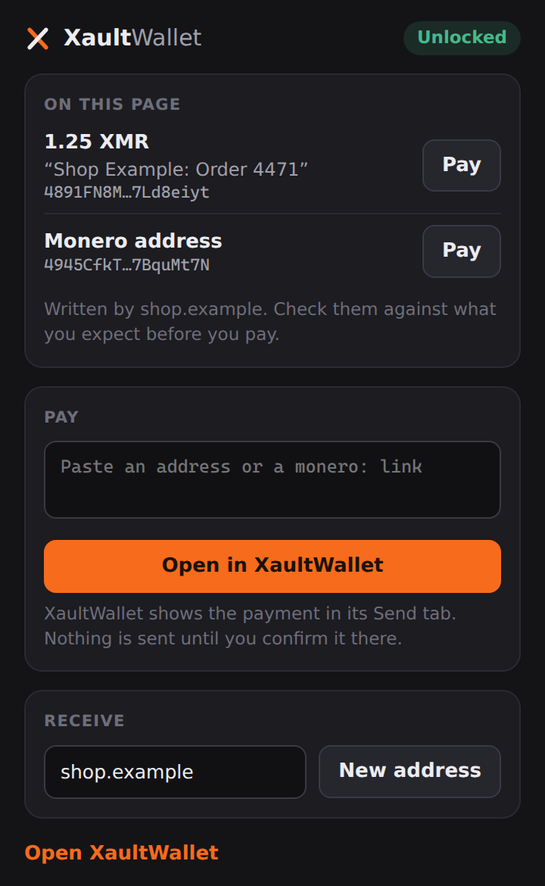
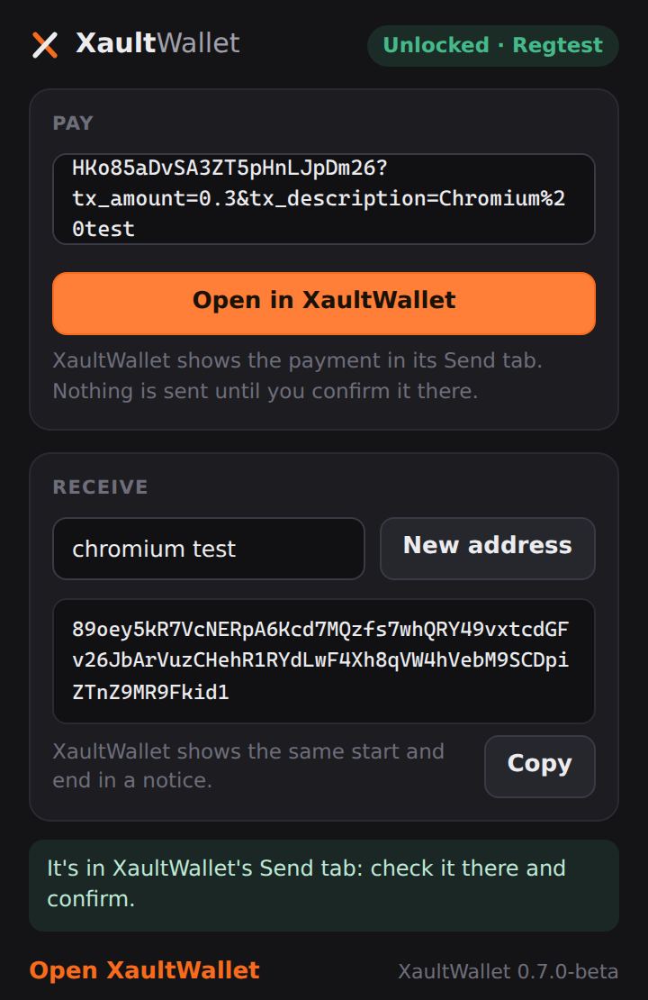

# The browser companion

A small extension for **Chrome** and **Firefox** that lets the browser hand payment requests to
XaultWallet and ask it for receive addresses. **The extension holds no key, no seed, no password, no
balance and no history**, and it stores nothing. XaultWallet on your computer does everything that
matters; the browser can only ask, and you confirm in the app.

<p align="center">
  
  
</p>

What it does:

- **Pay from a page.** Its popup lists the `monero:` payment links and Monero addresses you can see on
  the page you're on (looked for only when you open the popup), says which site it read them on, and
  shows what the page wrote about each one in quotes. *Pay* opens that payment in XaultWallet's Send
  tab, with the page it came from. Or paste an address or link into the popup. Or select an address
  on any page, right-click, *Pay with XaultWallet*. Plain `http` pages are flagged: anyone on the
  network could have changed what they show.
- **Get a receive address.** *New address* asks XaultWallet for a fresh subaddress of the wallet on
  screen, to paste into a form. The first click only asks: XaultWallet shows which site asks, with
  *Give address*; once you click that in the app, *New address* again (within two minutes, from the
  same site) gets the address. XaultWallet announces its start and end across the top of its window,
  and lists it on its Receive tab labelled *Browser* (with the site, or what you typed, only if you
  turned on *Label browser addresses with the site* in Settings).
- **Status.** Whether XaultWallet is running, locked or unlocked, and whether the wallet is ready
  (never its name, balance, network or kind).

Nothing is ever sent from the browser. A payment request only fills XaultWallet's Send form; you
review it there (the confirmation says it came from outside XaultWallet, from your browser
(shop.example), and that XaultWallet can't confirm who sent it) and press *Send now* in the app, as for
any payment. If the Send form already holds a payment you started, or one that may have gone out and
needs checking, a request doesn't replace it: it waits across the top of the window, and *Open it* puts
it in the form.

## Install

1. **Connect the browser in XaultWallet.** Settings, *Browser companion*, *Connect* next to Chrome or
   Firefox. This writes a native messaging host manifest (and on Windows a registry key under
   `HKEY_CURRENT_USER`) naming this XaultWallet and the one extension allowed to use it. *Disconnect*
   removes it; uninstalling XaultWallet removes it too. **Until you connect a browser, XaultWallet
   answers no browser at all** (error `not-connected`): the local channel stays open only so a second
   launch can hand over a clicked `monero:` link, and a link can only open a payment request or the
   window, never ask for the state or an address. An install that already had a browser connected
   keeps it connected.
2. **Install the extension.** From a release: `XaultWallet-<version>-browser-chrome.zip` or
   `…-browser-firefox.zip` (checksums in `SHA256SUMS`). From source: `node extension/build.mjs`
   (Node 20 or later, no dependencies) writes `extension/dist/chrome` and `extension/dist/firefox`.
   - **Chrome** (other Chromium browsers look in their own folders and registry keys, which Connect
     doesn't write): unzip, open `chrome://extensions`, turn on *Developer mode*,
     *Load unpacked*, choose the folder. Its id must read `kpcmnhbbahdifkhgibnboafelgfkgcdj`: that is
     the only Chrome extension XaultWallet answers.
   - **Firefox**: release Firefox only installs extensions Mozilla has signed. Until the companion is
     listed on addons.mozilla.org, load it from `about:debugging`, *This Firefox*, *Load Temporary
     Add-on* (it stays until Firefox restarts), or sign it for yourself as an unlisted add-on, or use
     Firefox Developer Edition or Nightly. Its id is `xaultwallet-companion@dboudreau.dev`.
3. **Allow the extension, once.** The first time the extension in a connected browser reaches
   XaultWallet, the app comes forward with *A browser extension wants to connect*, naming the browser
   and the extension id, with *Allow* and *Deny* (Allow ignores clicks for a moment after it appears).
   Until you answer, the extension gets `busy`; after *Deny* it gets `not-connected`. The answer is
   kept in the settings and shown next to the browser in Settings; *Disconnect* forgets it, so
   connecting again asks again. Installs updated from 0.7.0a are asked once too.
4. **Optional: let XaultWallet open `monero:` links** (Windows and Linux): Settings, *Browser
   companion*, *Open them here*. A click on a `monero:` link in any browser then starts XaultWallet (or
   hands the link to the copy already running) with the payment waiting in the Send tab. This needs no
   extension at all.
5. **Using the zip or tar copy:** disconnect browsers and links in Settings before you delete or move
   it. There is no uninstaller to do it for you.

Paths it writes: Windows `%LOCALAPPDATA%\XaultWallet\browser\dev.dboudreau.xaultwallet.chrome.json` and
`.firefox.json`, named by `HKCU\Software\Google\Chrome\NativeMessagingHosts\dev.dboudreau.xaultwallet`
and `HKCU\Software\Mozilla\NativeMessagingHosts\dev.dboudreau.xaultwallet`; `monero:` links under
`HKCU\Software\Classes\monero`. Linux `~/.config/google-chrome/NativeMessagingHosts/` and
`~/.mozilla/native-messaging-hosts/` (`dev.dboudreau.xaultwallet.json`), and for links
`~/.local/share/applications/xaultwallet-monero-link.desktop` plus a line in `~/.config/mimeapps.list`.
macOS `~/Library/Application Support/Google/Chrome/NativeMessagingHosts/` and
`~/Library/Application Support/Mozilla/NativeMessagingHosts/` (no `monero:` links on macOS: the release
is a plain executable, not an app bundle).

## How it fits together

```
 Chrome / Firefox                       your computer, your user only
┌─────────────────────┐ native     ┌──────────────────────┐  local pipe   ┌──────────────────────┐
│ companion extension │ messaging  │ XaultWallet.exe,      │  (Windows) or │ XaultWallet (running)│
│ popup, right-click  │──────────▶ │ started as the native │ ────────────▶ │ checks every request,│
│ no keys, no storage │ (stdin/out)│ host: no window, no   │  Unix socket  │ shows it, you confirm│
└─────────────────────┘            │ vault, passes messages│  (same user)  │ (vault, keys, sends) │
                                   └──────────────────────┘                └──────────────────────┘
```

- The browser starts XaultWallet's own executable as the **native messaging host** only for the
  extension the manifest names (Chrome checks `allowed_origins`, Firefox `allowed_extensions`). The
  host checks it again from the command line the browser gave it, and refuses anything else.
- The host carries one message at a time to the running app over a **local channel only your user
  account can open**: a named pipe on Windows, a Unix socket in your private runtime folder
  (`/run/user/<uid>`) or in XaultWallet's own `0700` data folder elsewhere. Both ends check that the
  other side runs as the same user, and on Windows the pipe also refuses connections from the network.
  (Where the data folder's path is too long for a socket, the companion and links stay off and the app
  says so; the channel is never moved to the shared temp folder.)
- For *Pay* or *Open XaultWallet* while the app isn't running, the host starts it (and then passes the
  request on). Status and *New address* never start it. A copy that is running but busy or still
  starting is waited for, never started a second time.
- The host passes on only the fields each kind of reply has (below), each checked; anything else the
  channel brings back is dropped.
- A second launch of XaultWallet (a `monero:` link Windows or Linux hands to it) uses the same channel to
  pass the link to the copy already running.

## Protocol, version 1

One JSON object per request and per reply. The browser frames each with its length (a 32-bit
little-endian integer, at most 64 KiB accepted); the local channel uses one line each (at most 16 KiB).
Every field is checked by the host and again by the app. Unknown fields are ignored; a field twice,
another version, an unknown type or a bad value is refused.

Requests:

| `type` | Fields | What happens |
|---|---|---|
| `status` | | The app's state. |
| `show` | | The window comes forward (the app starts if it isn't running). |
| `pay` | `uri` (a `monero:` link, at most 4096 characters, nothing hidden in it), `origin` (optional: the page, `https://host[:port]` or `http://host[:port]`, an IPv6 host in brackets) | The link opens in the Send tab (after the next unlock if the vault is locked). The app starts if it isn't running. |
| `receive` | `label` (optional, at most 40 characters), `origin` (optional) | A new subaddress of the wallet on screen, once the user allowed it in the app; until then error `busy`. |

Every request carries `"v": 1` and an `"id"` (1 to 64 letters, digits, `-` or `_`) that its reply repeats.

```json
{"v":1,"id":"7f3a9c21e0b44d58","type":"pay","uri":"monero:8B…?tx_amount=1.25&tx_description=Order%204471","origin":"https://shop.example"}
```

Replies are `{"v":1,"id":…,"ok":true,…}` with:

- `status`: `"app": "XaultWallet"` and `"state"` (`setup`, `locked` or `unlocked`); when unlocked also
  `"ready"`. Nothing else: not the version, the network or whether the wallet is watch-only (XaultWallet
  0.7.0a and earlier sent those; the extension still accepts them from an older app).
- `pay`: `"result"`: `shown`, `after-unlock` (it waits for the unlock), `waiting` (it opens when
  Settings closes) or `held` (the Send form is in use: it waits behind *Open it* in the app).
- `receive`: `"address"` and `"network"`.

or a refusal, `{"v":1,"id":…,"ok":false,"error":{"code":…,"message":…}}`, with one of these codes:
`bad-request`, `too-large`, `unsupported-version`, `unknown-type`, `not-running`, `no-vault`, `locked`,
`not-ready` (the wallet is still starting, or the app is busy), `busy` (a payment is being confirmed in
the app, or another screen covers the wallet), `watch-only` (the wallet on screen can't pay),
`too-many` (more than 6 payment requests, 5 new addresses, 10 *show* or 60 *status* requests a minute),
`failed`, `not-connected` (this browser isn't connected in XaultWallet's Settings). Messages are fixed sentences: no error text from inside the app reaches the browser.

## Threat model

**The rule:** the browser is untrusted. It can ask, it can never decide, and it holds nothing worth
stealing.

**What it protects against**

- **Infostealers that copy browser data.** Wallet extensions that keep an encrypted vault in the
  browser profile get it stolen and cracked. This one keeps nothing: no storage permission, no
  `localStorage` or IndexedDB, no keys, no seed, no balance, no address book. A copied browser profile
  holds the extension's code and nothing else of yours.
- **Web pages.** A page can't talk to the extension: it has no content scripts, no
  `externally_connectable`, no web-accessible resources (so a page can't even detect it), and its pages
  forbid network access (`connect-src 'none'`). The popup reads the page only when you open it: its
  text and the contents of its form fields, from which it keeps only `monero:` links and Monero
  addresses. It leaves out what a person can't see (hidden or transparent text, text off the page,
  hidden and password fields), names the site it read, and shows the page's own words in quotes.
  Nothing goes to XaultWallet until you press Pay. Names and descriptions in the list come from the
  page; check the address itself. A right-click payment names the frame the selection is in, not the
  page around it.
- **Other extensions.** The native host answers only the companion's id (Chrome checks the origin,
  Firefox the add-on id, and the host checks both again). An unpacked extension carrying the
  companion's public key gets the same Chrome id, so this keeps out other installed extensions, not a
  copy someone loads on purpose.
- **Other people on the computer.** The local channel is limited to your user account; a server or
  client running as anyone else is refused, and on Windows so is your own account connecting from
  another computer.
- **A compromised browser tab.** Browser content runs sandboxed; it can't open the channel, and
  nothing the app sends back is a secret.
- **An address swapped by something else.** A payment request is only ever a proposal in the Send
  tab, with where it came from shown first, on the form and on the confirmation, and the request's own
  words in quotes, cleaned of anything that changes how text reads (line breaks, right-to-left
  overrides, invisible characters). A request never replaces a payment being confirmed; one that would
  replace a form you filled, or a payment that may have gone out, waits behind *Open it*. *Review* and
  *Send now* ignore clicks for a moment after a request lands or the confirmation appears. A new
  receive address is made only after you press *Give address* in the app (which, like *Send now*,
  ignores clicks for a moment after it appears, because the window comes forward with it; with Enhanced Security on,
  only your own keyboard, mouse, touchscreen or pen can, not another program), is announced across the top of the app's window with its start and end, and
  labelled *Browser* on the Receive tab, to compare with what the browser shows. The page a request
  came from is what the extension reports; a program on your computer can claim any page.
- **Being repointed.** At every start, and when its window comes back to the front, XaultWallet checks
  that each browser connection it made still leads to it, comparing the exact path it wrote and the program file there (SHA-256, against the running app as it started: a file replaced at the same path is reported too). If another
  program rewrote one (to stand in for XaultWallet and, say, hand your browser its own "receive"
  address), you get a warning across the top of the window naming the program it now leads to. A
  connection that was removed is mentioned once, then forgotten. The same goes for `monero:` links. On
  Windows, a program that takes the channel's name before XaultWallet starts is noticed and reported;
  one that joins it after XaultWallet has started is not.
- **Floods.** At most 6 payment requests, 5 new addresses, 10 *show* and 60 *status* requests a
  minute, and the window comes forward at most every two seconds. A message over 64 KiB from the
  browser, or a request over 16 KiB on the local channel, is refused.
- **Someone at the locked computer.** While XaultWallet is locked, its lock screen says only that a
  payment request is waiting, not where it came from. A request waits at most 10 minutes.

**What it does not protect against**

- **Malware running as you that can do what you can.** It can read and write your files, log your
  keystrokes, read the memory of your programs (unless Enhanced Security is on, see below) and rewrite
  any of the files and registry keys above. No software wallet survives that; the companion doesn't
  make it worse (there is nothing in the browser to steal), and the tripwire catches one way of abusing
  the companion, repointing its registration. Such a program has others (answering on the channel,
  editing an unpacked extension), so compare addresses with the app. Keep real funds where malware isn't.
- **A malicious update of the extension.** It still couldn't sign or send anything, but it could
  propose a payment to its own address or show you an address that isn't yours. Check what the app's
  confirmation says, and compare addresses with the app. Install the companion only from this
  repository's releases or its official store listing.
- **A Firefox add-on registered under the same id before the official listing exists.** Until the
  companion is published on addons.mozilla.org, someone else could publish an add-on with its id there.
  Install only from this repository. (The Chrome id comes from the public key in the extension's
  manifest, whose private half was never kept, so no store listing can claim it; a store listing would
  get an id of its own, added to the app in a release. Anyone can still load an unpacked copy with that
  key and get the same id, so install only from this repository.)
- **Whoever sees your screen.** The popup shows the receive address it got.
- **Telling your profiles apart.** Status no longer says the network of the wallet on screen or whether
  it is watch-only. An address you give the browser carries its network, so a decoy on another network
  than your real wallet can be told apart then; keep them on the same network if that matters to you.

## Enhanced Security

Settings, *Enhanced Security* (Windows, off by default) takes away common ways malware watches and
drives a desktop wallet: screenshots and recordings show nothing where the window is, key presses and
clicks that didn't come from a device are dropped (so hidden-VNC tools can't press its buttons), other
programs can't read its window through accessibility interfaces or open its memory (or its wallet
backend's), and it won't start on a hidden desktop. It doesn't cover the companion's channel: a program
running as you can still put a payment in the Send form, so check the address before you press
*Send now*. Screen readers, voice control, password-manager auto-type and remote-control tools can't
operate XaultWallet while it is on. When you turn it on, XaultWallet asks for one click: if your click
doesn't get through (an unusual input device), it turns itself off again, and it is kept on only once
you click. If it stops taking your input later, close XaultWallet and start it once with
`XaultWallet.exe --no-enhanced-security`. See [SECURITY.md](../SECURITY.md#enhanced-security).

## Developing

- `node --test extension/test/*.test.mjs`: the extension's unit tests (Node's own runner, no
  dependencies).
- `node extension/build.mjs [--zip <dir> --name <prefix>]`: both builds, and reproducible zips. The build
  stops if the extension ids it produces aren't the ones the app allows
  (`src/XaultWallet.Core/Companion/BrowserRegistration.cs`).
- The end-to-end runs exercise the real native host: the Linux headless run and the Windows run of the
  published exe ask for status, a receive address and a payment (one into an empty form, one held
  behind *Open it* over a form the user changed, one while locked), and check what happens in the
  app's own screens.
